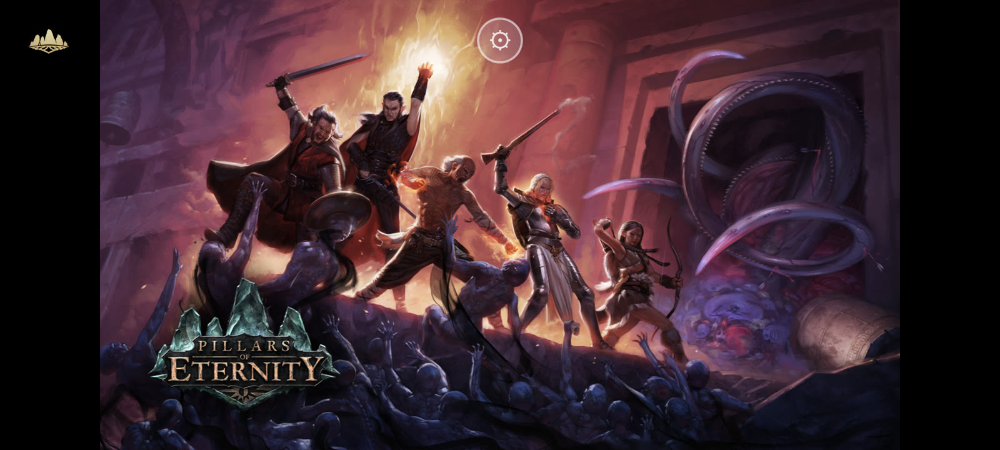
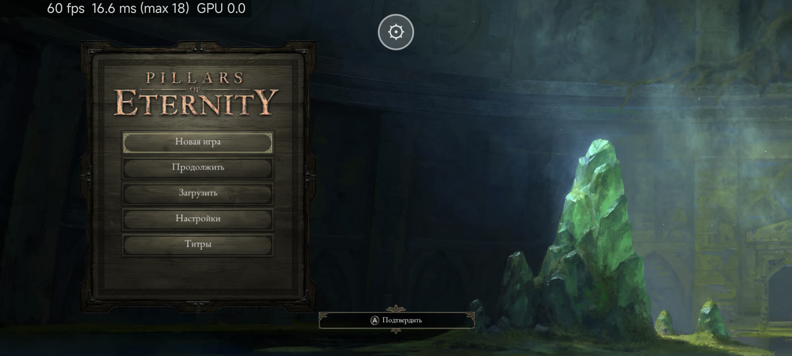
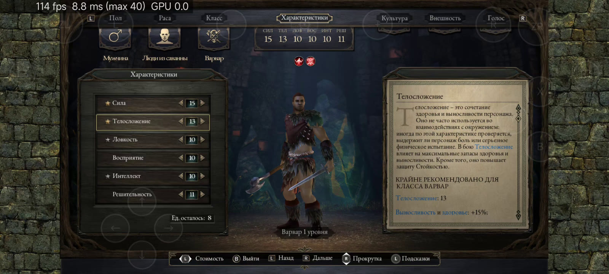
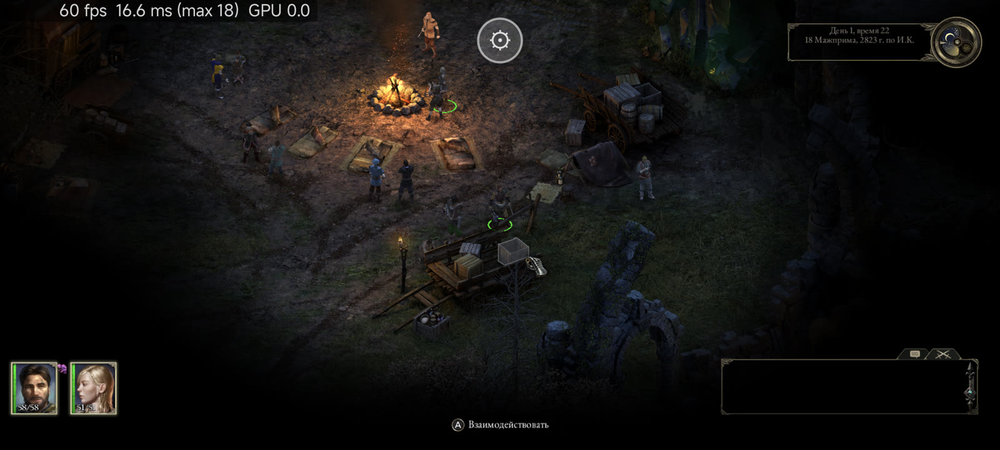
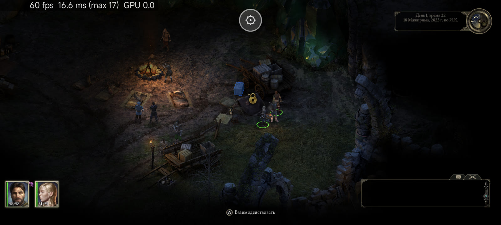
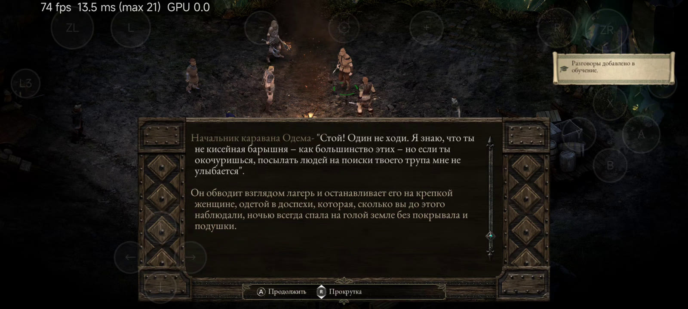
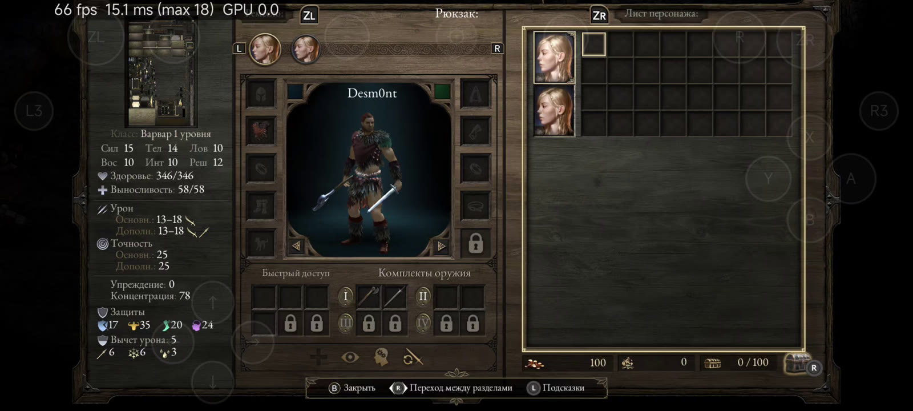
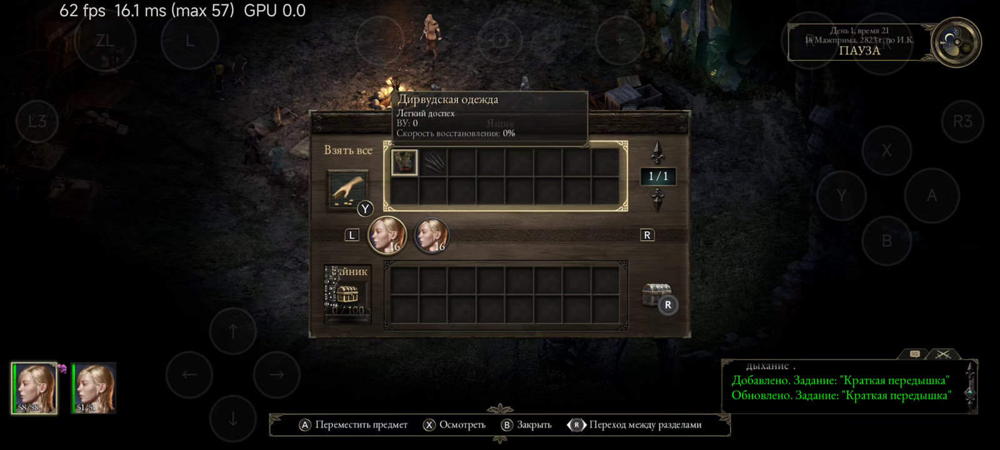
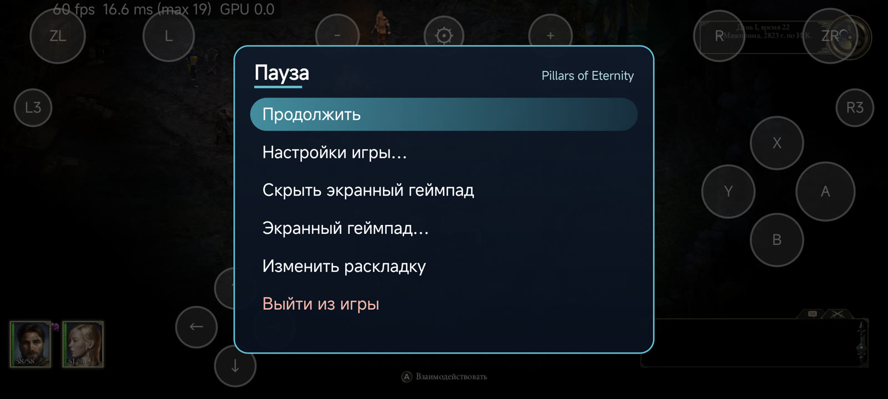
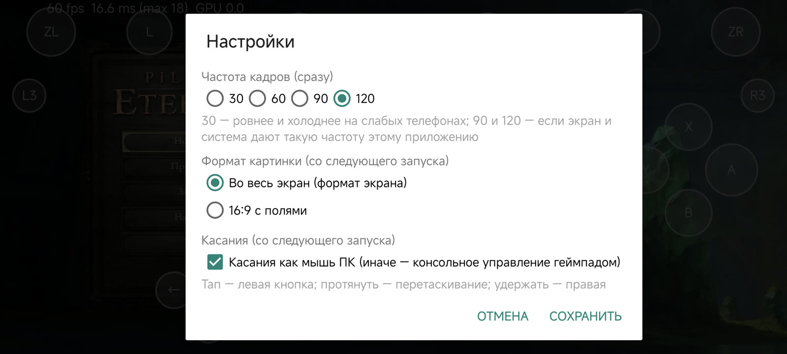

# Pillars of Eternity Mobile

**A native Android port of Pillars of Eternity: Complete Edition for Nintendo Switch.** The game is made on Unity
2018.1, so the Switch Unity player is thrown out: the game's own compiled code from your dump runs in the stock Android
Unity player of the same version (2018.1.4f1) and talks to Android and the phone's GPU directly. No emulator, no JIT, no
NVN → Vulkan layer; only the shaders are recompiled for Vulkan, once, on your PC. You bring the game: this repository
contains no game content and no keys.

Русский: [ниже](#по-русски).

**Install:** step-by-step guide for players — [docs/INSTALL.md](docs/INSTALL.md) (English) ·
[docs/INSTALL.ru.md](docs/INSTALL.ru.md) (по-русски). In short: dump your own game + update v393216 and `prod.keys`, put
them into `put-game-files-here/`, double-click `setup.bat`, copy `work/PillarsOfEternityMobile` to the phone's
`Download` folder and install the APK from the
[Releases page](https://github.com/Desm0nt/pillars-of-eternity-port/releases/latest).

> [!WARNING]
> **Tested so far on two Snapdragon phones: Xiaomi 14 Ultra (Snapdragon 8 Gen 3 / Adreno 750) and Xiaomi 13 Pro
> (Snapdragon 8 Gen 2 / Adreno 740), both with the phone's own driver.**
> **Devices with Mali (Exynos, Dimensity, Tensor), PowerVR and Xclipse GPUs have not been tested at all** — setup can
> prepare a texture set for them, but expect problems. If something goes wrong on your device, please
> [open an issue](https://github.com/Desm0nt/pillars-of-eternity-port/issues) and **always attach the logs**: the whole
> folder `Download/PillarsOfEternityMobile/logs/` (`crash.txt`, `boot.log`, `logcat.txt` and their `.prev` copies) —
> and name your phone model and Android version. Without logs a report usually can't be acted on.

## Screenshots

Captured on the phone (Xiaomi 14 Ultra, Adreno 750): the game fills the 20:9 screen (nothing stretched). Game text in
Russian; touch plays as the PC mouse, so only the gear button is on screen (the character creation, dialogue, inventory
and loot shots come from a gameplay recording with the faded on-screen gamepad). The counter in the top-left corner is
the port's own FPS overlay (it can be turned off).

| | |
|---|---|
|  |  |
|  |  |
|  |  |
|  |  |

The gear button opens the pause menu; *Game settings…* holds the port's own options:

| | |
|---|---|
|  |  |

## What it is, and what it is not

**It is:**

- The original game code **running natively** in the **stock Android Unity player 2018.1.4f1**. The Switch Unity
  player is gone; a couple of `UnityEngine.Switch.*` calls that have no Android counterpart are stubbed (the game does
  not call them anyway).
- The game's shaders recompiled from the Switch's NVN (Maxwell) to Vulkan once, on your PC; the Android player draws
  with its own Vulkan renderer on the phone's own driver.
- A phone port: **touch that plays like the PC mouse**, an on-screen gamepad, game controllers, a picture that fills
  the phone's screen and a frame-rate limit up to 120 FPS.

**It is not:**

- An emulator, cloud gaming or streaming.
- **A source of game content.** There is no game program, data, shader, text, art or key in this repository, and the
  APK contains none. You dump the game from a Switch you own and convert it on your PC. What the repository knows about
  the game is listed in [docs/DERIVED.md](docs/DERIVED.md).
- Affiliated with Obsidian Entertainment, Versus Evil, Unity Technologies or Nintendo.

## Current state

Tested on **Xiaomi 14 Ultra** (Snapdragon 8 Gen 3 / Adreno 750, Android 16) and **Xiaomi 13 Pro** (Snapdragon 8 Gen 2 /
Adreno 740) with the phone's own Vulkan driver.

- Main menu at **120 FPS**, gameplay at **about 87 FPS** on the 14 Ultra (120 FPS limit). New game, character creation, saving and
  loading, portraits.
- **Complete Edition:** both parts of The White March are included.
- **Touch as the PC mouse:** tap = left click (select, move, attack, talk, any menu or window), hold = right click (hold
  time adjustable), two fingers = move the camera, pinch = zoom, two-finger tap = pause, two fingers held = select the
  whole party, three-finger tap = close a window.
- **On-screen gamepad** (if you prefer the console controls): floating sticks, skins and a layout editor, the same as
  in the DOOM / Diablo III / Torchlight II ports. Bluetooth / USB controllers work too.
- **Widescreen:** the picture fills the phone's screen in its own shape (e.g. 2000×900 on 20:9), or 16:9 with bars.
- Port settings (gear button): frame-rate limit 30 / 60 / 90 / 120 (switches at once), picture shape, touch as the
  mouse and hold time, game language (English, Russian, German, French, Spanish, Italian, Polish), FPS counter,
  on-screen gamepad, stick dead zone, menu language.

### Known issues

- **Fair warning:** the shaders are not native but converted, and the Android player was fitted to the game by
  matching function names from the decompiled code. Some features may work wrong, and texture or geometry errors may
  show up, because the Switch player could pass some things in a way the Android player doesn't expect — and Pillars
  on Switch is known to be buggy by itself.
- Only update **v393216** (2.60.00) is supported; setup checks the build id of the game program.
- Only two Snapdragon phones have been tested; the texture set for Mali / PowerVR / Xclipse has not run on such a phone yet.
- No rumble yet. No PC drag-to-select box (the console build simply doesn't have it).
- Saves live in the app's own folder (`Android/data/org.pillars.mobile/files/save`): updating the APK keeps them,
  **uninstalling the app deletes them**.
- Some Xiaomi / HyperOS phones keep the app at 60 Hz even with the 120 FPS limit (the system's own per-app refresh
  rate choice).

## Building

Players do not need this. Full guide: [docs/BUILD.md](docs/BUILD.md).

Requirements: **Unity 2018.1.4f1 with Android Build Support (IL2CPP)** (the build takes Unity's Android player and the
il2cpp runtime source from your install; nothing of Unity is stored here), Android NDK r29, Android SDK build-tools
36.1.0 + platform android-36, JDK 17+, Python 3.12+. Tool locations come from the environment or from a git-ignored
`build.local.env`.

```sh
build.bat                      # Windows: native libraries + signed release APK
python tools/build_native.py all && python tools/build_apk.py Release   # any OS
```

Output: `dist/PillarsOfEternity-Mobile-v<version>-arm64.apk`, app id `org.pillars.mobile`. The version comes from
`app/VERSION`. `work/` is git-ignored and holds every build output and every game-derived file.

## Installing

Full guide: **[docs/INSTALL.md](docs/INSTALL.md)** (English) / **[docs/INSTALL.ru.md](docs/INSTALL.ru.md)** (Russian).

1. Dump your own copy (base game `0100D6200E130000` + update `0100D6200E130800` **v393216**, as NSP / NSZ / XCI / XCZ)
   and your console's `prod.keys` — e.g. with nxdumptool and Lockpick_RCM on your Switch.
2. Put the files into `put-game-files-here/` (any names) and double-click `setup.bat` (`./setup.sh` for Linux / macOS
   is included but not tested yet; `setup.bat check` reports what is missing and changes nothing). Setup provides
   Python, its packages and the .NET 10 SDK in `tools/.runtime` when they are missing (it asks first), needs about
   **90 GB free** while it runs, asks which phone the game is for and makes `work/PillarsOfEternityMobile` (16 GB with
   BC textures, 15 GB with ASTC, 28 GB with both). About 20 minutes, up to 40 on slower PCs.
3. Copy `work/PillarsOfEternityMobile` to the phone's `Download` folder and install the APK.
4. Start *Pillars of Eternity Mobile* and allow *All files access* when asked.

## Other GPUs (Mali, PowerVR, Xclipse)

Untested on real hardware. Most of the game's textures are BC, which Adreno reads directly but Mali, PowerVR and the
stock Xclipse driver do not. Setup can build an **ASTC copy** of them (it asks: Adreno → BC, Mali / PowerVR / Xclipse →
ASTC, not sure → both), and the app picks the right set at every start (`texture set = ...` in boot.log). The rest is
up to Unity's own Android player, which is made for these GPUs. Reports (device, GPU, logs) are very welcome.

## Android versions and CPUs

- `PillarsOfEternity-Mobile-v<version>-arm64.apk`: Android 8.0 or newer, Vulkan required, 64-bit ARM only.

## Logs and crash reports

Every start writes `boot.log` and a live `logcat.txt` into `Download/PillarsOfEternityMobile/logs/` (the previous run
is kept as `.prev`). When the game crashes or is killed while playing, the next start writes **`crash.txt`** there.
Attach the whole `logs` folder to a bug report.

## Repository layout

| Path | What |
|---|---|
| `app/native/` | The native layer linked into `libil2cpp.so`: game-image loader, boot layer (Unity player hooks, picture, frame rate, touch, texture set, crash handler) and stand-ins for the Switch SDK calls |
| `app/java/`, `app/frontend/`, `app/front-assets/` | The Android activities, touch as the mouse, the port's settings, logs and crash reports, and the shared front end of the author's ports (pause menu, gear dialog, on-screen gamepad) |
| `profile/0100D6200E130000/` | The game profile: patches of `main`, memory layout, shader tables |
| `setup.bat`, `setup.sh`, `build.bat` | Game file preparation (`tools/setup_poe.py`) and APK build entry points |
| `tools/` | Setup, the overlay and ASTC tools, the native and APK builds |
| `third_party/nx2android/` | The vendored subset of nx2android (MIT): dump extractor, `main` rewriter, shader split and translator |
| `docs/` | Install and build guides, setup requirements, game-derived information, third-party code |

## Credits

Pillars of Eternity Mobile stands on the work of others — thank you:

- **[nx2android](https://github.com/shirai91/nx2android)** (MIT, seedds) — the Android port of
  [nxnative](https://github.com/seedds/nxnative); its extractor, `main` rewriter and Ryujinx-based shader translator do
  the heavy lifting in setup, and its gamepad themes are the on-screen pad's skins.
- **Ryujinx** shader translator (Ryujinx Team and Contributors, MIT), as nx2android vendors it.
- **[DOOM Mobile](https://github.com/Desm0nt/doom-port)**, **[Diablo III Mobile](https://github.com/Desm0nt/diablo3-port)**
  and **[Torchlight II Mobile](https://github.com/Desm0nt/torchlight2-port)** (which go back to
  **[d2r-mobile](https://github.com/jhaizhou-ops/d2r-mobile)** by jhaizhou, MIT) — the front end, logs and crash
  reports, setup and install flow.
- **Unity** 2018.1.4f1 Android player and il2cpp runtime (Unity Technologies) — taken from the developer's own install
  at build time, not stored here.
- **[SMOL-V](https://github.com/aras-p/smol-v)** (Aras Pranckevicius, public domain), **[AssetRipper](https://github.com/AssetRipper/AssetRipper)**
  type data, Arm's **[astc-encoder](https://github.com/ARM-software/astc-encoder)** (Apache-2.0, through astc-encoder-py).

Details per file: [docs/THIRD_PARTY.md](docs/THIRD_PARTY.md).

Pillars of Eternity is a trademark of its respective owners. Nintendo Switch is a trademark of Nintendo. Unity is a
trademark of Unity Technologies. This is an unofficial, non-commercial fan project with no affiliation to any of them.
**You must own the game and dump it yourself**: no game files, no keys and no game-derived output are included or
distributed here.

## License

MIT — see [LICENSE](LICENSE). The d2r-mobile copyright notice is kept; third-party components keep their own licenses.

---

## По-русски

> [!WARNING]
> **Проверено только на двух телефонах со Snapdragon: Xiaomi 14 Ultra (Snapdragon 8 Gen 3 / Adreno 750) и Xiaomi 13 Pro
> (Snapdragon 8 Gen 2 / Adreno 740).** Телефоны с GPU **Mali**
> (Exynos, Dimensity, Tensor), **PowerVR** и **Xclipse** не тестировались вообще — набор текстур для них установка
> готовит, но проблемы вероятны. Если что-то не работает,
> [откройте issue](https://github.com/Desm0nt/pillars-of-eternity-port/issues) и **обязательно приложите логи** — всю
> папку `Download/PillarsOfEternityMobile/logs/`, и укажите модель телефона и версию Android.

**Pillars of Eternity Mobile** — нативный порт Pillars of Eternity: Complete Edition для Nintendo Switch на Android.
Игра сделана на Unity 2018.1, поэтому Switch-плеер Unity выкинут: код игры из вашего дампа работает в штатном
Android-плеере Unity той же версии и напрямую работает с Android и GPU телефона. Без эмулятора, JIT или слоя
NVN → Vulkan; перекомпилированы только шейдеры (один раз на ПК).

- **Игры в репозитории нет.** Нужна своя копия игры для Switch (база + обновление v393216) и свои ключи консоли.
  **Установка по шагам: [docs/INSTALL.ru.md](docs/INSTALL.ru.md).** APK — на странице
  [Releases](https://github.com/Desm0nt/pillars-of-eternity-port/releases/latest).
- **Вся игра:** основная кампания (обе части) и The White March. Сохранения и портреты работают.
- **Касания как мышь ПК:** тап — левая кнопка, удержание — правая, два пальца — камера, щипок — зум, тап двумя пальцами —
  пауза, два пальца удержать — весь отряд, тап тремя — закрыть окно. Есть и экранный геймпад, и обычные геймпады.
- **Картинка на весь экран** в пропорциях телефона или 16:9 с полями; **лимит кадров 30 / 60 / 90 / 120** прямо в игре.
- Проверено на Xiaomi 14 Ultra и Xiaomi 13 Pro; на 14 Ultra главное меню — **120 fps**, в игре — **около 87 fps**.
- **Честное предупреждение:** шейдеры не родные, а приёмные, и плеер подгонялся по совпадениям имён функций из
  декомпиляции, поэтому возможны ошибки текстур и геометрии: плеер Switch мог передавать что-то неожиданно для плеера
  Android, да и сама PoE на Switch довольно кривовата.
- **Ограничения:** только обновление v393216; вибрации нет; рамки выделения отряда, как на ПК, нет; удаление
  приложения стирает сохранения; на некоторых Xiaomi система держит приложение на 60 Гц.
- Подготовка файлов: положите базу, обновление и `prod.keys` в `put-game-files-here/` и дважды щёлкните `setup.bat`.
  Нужно около 90 ГБ свободного места, 20–40 минут. Готовую папку `work/PillarsOfEternityMobile` (15–28 ГБ) скопируйте в
  `Download` телефона.
